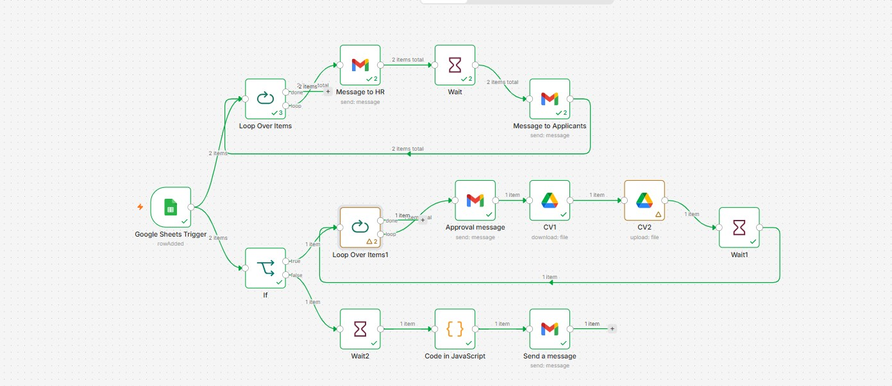

# Automated Applicant Screening Workflow (n8n)

An n8n automation that handles new job applications from start to finish. When an applicant is added to a Google Sheet, it notifies HR, confirms receipt to the applicant, sorts applicants by a screening condition, and sends the right follow-up email. For approved applicants, it also copies their CV to a separate Google Drive folder.

## The problem it solves

Reviewing applications by hand means a lot of repetitive emailing and file sorting. This workflow does that automatically, so HR only sees the applications that need attention and every applicant gets a timely response.

## Tools used

- **n8n** (workflow automation)
- **Google Sheets** (applicant data and trigger)
- **Gmail** (notifications and applicant emails)
- **Google Drive** (CV storage)
- **JavaScript** (custom logic in a Code node)

## How it works

1. **Trigger:** A new row is added to the Google Sheet (a new applicant).
2. **Notify HR and confirm to applicant:** For each new applicant, the workflow emails HR, waits briefly, then sends the applicant a confirmation message.
3. **Screening check:** An **If** node checks [your condition, e.g. whether the applicant meets the requirements].
4. **If approved:**
   - An approval email is sent to the applicant.
   - Their CV is downloaded from Google Drive and uploaded to [shortlisted folder].
   - A short wait runs before moving to the next applicant.
5. **If not approved:** After a short wait, a JavaScript node prepares the message and a follow-up email is sent to the applicant.

## How to use it

1. Download `TSAssignment complete (3).json` from this repo.
2. In n8n, go to **Workflows → Import from file** and select the file.
3. Connect your own **Google Sheets**, **Gmail**, and **Google Drive** credentials.
4. Point the trigger at your own Google Sheet and update the folder and email settings.
5. Activate the workflow.

## Contact

Name: Elijah Babarinde | Email: elijahbabarinde2002@gmail.com | linkedIn: linkedin.com/in/elijah-babarinde-64b207280
